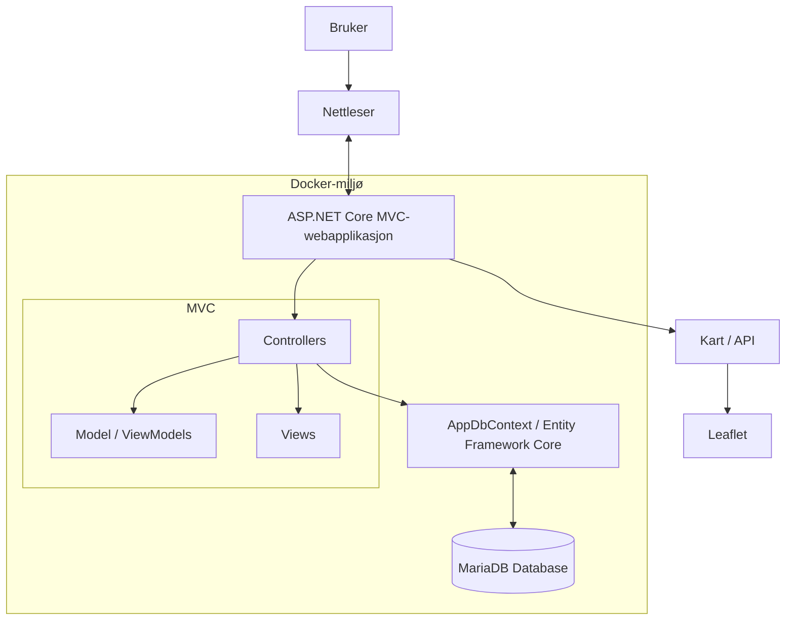

# System arkitektur

For denne webapplikasjonen har vi tatt i bruk MVC rammeverket (Model, View og Controllers). Webapplikasjonen er bygget som en monolittisk løsning, hvor kjernefunksjonaliteten er samlet i en webapplikasjon og kjører som en enhet. Dette gjør at de ulike delene av systemet er samlet i samme prosess, samtidig som webapplikasjonen kan kommunisere med og benytte eksterne tjenester ved behov (Microsoft Learn, 2023).

## Drift og Kjøring

Webapplikasjonen er en ASP.NET Core MVC-applikasjon som kjøres i en Docker-container.

### Forutsetninger

- Docker Desktop må være installert og kjøre.
- Maskinen må ha tilgang til internett første gang prosjektet bygges, fordi Docker
    henter .NET-images og NuGet-pakker.
- Nettleseren må ha internettilgang for å laste kartdata fra Leaflet/OpenStreetMap.

### Starte applikasjonen
Siden prosjektet fortsatt er i testfasen, så kjører vi disse to kodene, dette er hver gnag vi gjør endringer og ønsker å starte med red database. Dette sletter tidligere testdata.
Ved nye endringer, i vårt tilfelle:
```bash
docker compose down -v
```

Til vanlig bruker man bare :
```bash
docker compose down
```

Deretter starte den opp igjen:

```bash
docker compose up --build
```

Når containerne er startet, er webapplikasjonen tilgjengelig på:

`http://localhost:8081`

Ressurser, behov, brukere og tilhørende informasjon lagres nå permanent i MariaDB-databasen. Webapplikasjonen kommuniserer med databasen for å hente og lagre data. Dataene blir bevart selv om webcontaineren starter på nytt, så lenge databasen og dataen ikke slettes


### Feilsøking

Se status og logger med:

```bash
docker compose ps
docker compose logs web
```

Dersom port `8081` allerede er i bruk, må portmappingen i `docker-compose.yml`
endres.


## MVC rammeverket og hvordan det henger sammen

MVC rammeverket består av Models, Views og Controllers, hvor hver del har sitt eget ansvarsområde. Controller fungerer som et bindeledd mellom brukeren og webapplikasjonen. Den mottar forespørsler fra nettleseren, behandler forespørselen og bestemmer hva som skal returneres tilbake til brukeren. Controlleren kan hente eller lagre data gjennom webapplikasjonens datakomponenter før den returnerer et View.
Et view er det brukeren ser og samhandler med i nettleseren. Det består av HTML markup og dynamisk innhold som sendes til nettleseren. En controller kan returnere en view som viser informasjon til brukeren.
Til sist har vi Model som representerer dataen som brukes i webapplikasjonen. Den kan blant annet inneholde egenskaper for dataene og regler for validering. I webapplikasjonen brukes modeller og viewmodeller til å overføre og håndtere data mellom ulike deler av systemet. I webapplikasjonen brukes modeller til å representere informasjonen som systemet jobber med. 

ResourceEntry representerer en ressurs som registreres i systemet. Når informasjonen skal lagres eller hentes, kommuniserer den med MariaDB-databasen. 
Sammen gjør disse komponentene at webapplikasjonen får en tydelig struktur, hvor presentasjon, håndtering av forespørsler og data er delt opp i separate deler (Walther, 2022).

## Hvordan data flyter gjennom systemet (eksempel fra koden)
Data flyter gjennom systemet ved at brukeren sender en forespørsel fra nettleseren til webapplikasjonen. Forespørselen mottas av en Controller, som behandler informasjon og vil da eventuelt kommuniserer med databasen gjennom AppDbContect om dette er relevant. Controlleren retunerer deretter en View som presenterer resultatet for brukeren.

Et eksempel på dette er når en bruker registrerer en ny ressurs. Brukeren fyller ut registreringsskjemaet på nettsiden og trykker på "Register resource". Skjemaet sender informasjonen til HomeController gjennom en POST-forespørsel til metoden RegisterResource.
Dataene sendes til controlleren som et ResourceEntry-objekt. Dette objektet inneholder informasjon brukeren har fylt inn om ressursen. 

Før ressursen lagres, kontrollerer systemet om informasjonen er gyldig ved hjelp av ModelState.IsValid. Dersom informasjonen ikke består valideringen, sendes brukeren tilbake til registreringsskjemaet med en eller flere feilmeldinger som forklarer hva som "feilet". Hvis informajsonen er gyldig, kontrollerer systemet hvilken rolle brukeren har, og knytter deretter ressursen til riktig bruk ved å sette blant annet ProviderId, RegionId og registeringspunktet.

Til slutt legges ressursen inn i databasen gjennom AppDbContext ved hjelp av _db.Resource.Add(resource). Og endringer lagres med _db.SaveChanges(), da vil Entity Framework Core håndtere kommunikasjonen med MariaDb-databasen. 

## Hvordan bruker, webapplikasjon og eventuelle andre komponenter henger sammen
Systemet består av en bruker som kommuniserer med webapplikasjonen gjennom en nettleser. Webapplikasjonen er utviklet med ASP.NET Core og MVC og håndterer forespørsler, data og visning. Webapplikasjonen har også mulighet til å kommunisere med andre komponenter, som karttjenesten, for å hente og lagre nødvendig informasjon. 

Ressurser, behov, brukere og annen informasjon lagres i MariaDB-databasen. Webapplikasjonen bruker AppDbContext og Entity Framework Core for å hente og lagre informasjon. Databasen kjører i egen Docker-container, adskilt fra selve webapplikasjonen.

Docker brukes til å pakke webapplikasjonen og dens avhengigheter inn i et isolert miljø, dette gjør at webapplikasjonen kan kjøres på samme måte på ulike maskiner og miljøer (dockerdocs, u.d.). I prosjektet bruker vi Docker Compose til å starte og administrere webapplikasjonen lokalt. ASP.NET Core-webapplikasjonen bygges ved hjelp av en Dockerfile.

Slik henger komponentene sammen illustrert med et diagram:
### Systemarkitektur

Slik henger komponentene sammen:



## Responsivt design

Vi har tilpasset webapplikasjonen slik at den fungerer på både store og små skjermer. På større skjermer vises ressursregistreringen i et sidepanel ved siden av kartet. På mindre skjermer får kartet mest mulig plass, mens navigasjonen flyttes til bunnen av skjermen og ressursregistreringen åpnes som et panel over kartet.

Det responsive oppsettet er laget med CSS media queries og fleksible høyder og bredder. Når sidepanelet åpnes eller lukkes på mobil, beregnes kartets størrelse på nytt slik at kartet fortsatt vises riktig. Vi har også beholdt koblingen mellom kartet og ressursregistreringen, slik at et valgt punkt i kartet fyller inn breddegrad og lengdegrad i skjemaet. På denne måten kan brukeren registrere ressurser uavhengig av hvilken skjermstørrelse som brukes (MDN, u.d.).

Navigasjonen bruker Bootstrap Icons for å gjøre knappene og sidene lettere å kjenne igjen.

# Bruk av kunstelig intelligens (KI/AI) under prosjektet
Vi har brukt KI som et støtteverktøy gjennom prosjektet. Vi har ikke brukt KI for å genere ferdig tekst eller kode, men heller som læringsverktøy, til å skjønner hva oppgaven spør om, feilsøking og forklaring av feilmeldinger, men også om vi mangler noe i teksten, eller dokumentasjon.

## KI-Verktøy ##
Disse har hovedsakelig blitt brukt til å forklare tekniske konsepter innenfor programmering, forstå feilmeldinger, videreutvikle ideer til systemets funksjonalitet.
•	Claude, Sonnet 5/5.5
•	GitHub Copilot

Disse ble brukt for å vise til skrivefeil i tekst og omstrukturering, slik at alt blir gramatisk riktig.
•	ChatGPT
•	Microsoft Copilot

Vi har selv vurdert, tilpasset og testet forslagene fra KI før implementasjon. KI har dermed blitt brukt som et støtteverktøy for læring, ideutvikling og problemløsning.
### Noen prompts vi har brukt aktivt gjennom innleveringen er:

•	Kan du hjelpe oss med å forstå denne feilmeldingen?

•	Hvorfor sliter docker/mariaDB med å starte?

•	Kan du forklare denne kodeblokken?

•	Hva er MVC komponenter?

•	Hvorfor vil ikke webapplikasjonen kjøre?

•   Gi meg tilbakemelding på besvarelse ifht. oppgavetekst

## Refleksjon ##
Alle forslag fra KI ble vurdert og testet før det ble tatt i bruk. KI ble brukt som støtte for læring og problemløsning, ikke som erstatning for eget arbeid. Gruppen hadde selv ansvaret for implementasjon og endelige beslutninger.

# Bibliografi

dockerdocs. (u.d.). What is Docker? Hentet fra https://docs.docker.com/get-started/docker-overview/

Microsoft Learn. (2023, Juli 3). Common web application architectures . Hentet fra https://learn.microsoft.com/en-us/dotnet/architecture/modern-web-apps-azure/common-web-application-architectures

Walther, S. (2022, November 7). Understanding Models, Views, and Controllers (C#) . Hentet fra https://learn.microsoft.com/en-us/aspnet/mvc/overview/older-versions-1/overview/understanding-models-views-and-controllers-cs

MDN. (u.d.). Responsive web design. Hentet fra https://developer.mozilla.org/en-US/docs/Learn_web_development/Core/CSS_layout/Responsive_Design

I denne oppgaven brukte jeg ChatGPT-5.6 Luna til å identifisere og rette opp grammatiske feil, forbedre språkstrukturen, finne synonymer, forkorte teksten og hjelp med generering av diagrammet i GitHub. Jeg brukte ikke ChatGPT-5.6 Luna til å skrive hele avsnitt, men heller til å forbedre min egen tekst, der jeg korrekturleste og kvalitetssikret teksten. Jeg har brukt ChatGPT i tråd med UiAs retningslinjer for bruk av kunstig intelligens.
